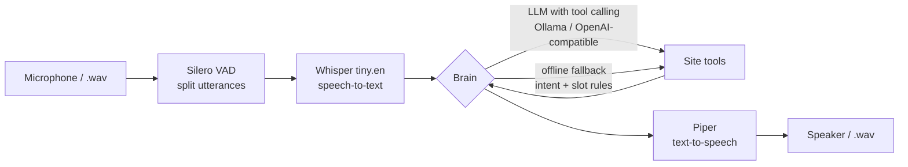
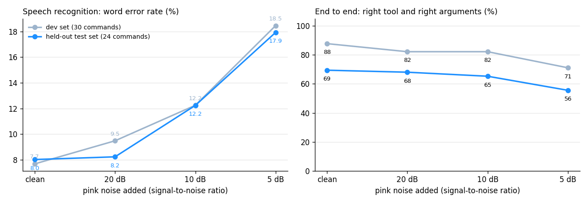
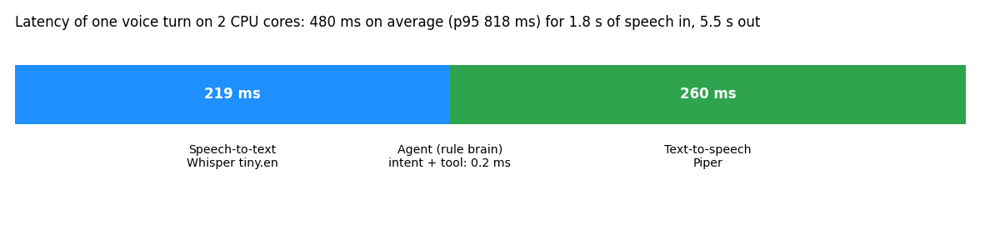

# Voice agent for site technicians: offline speech-to-text, tool calling, text-to-speech


A hands-free voice assistant for technicians on a construction site: they speak (*"There is a
crack on wall twelve, level two, it looks major"*), the agent understands the request, calls the
right tool (log a defect, read a checklist step, set a timer, calculate…) and answers out loud.
Everything runs **offline on CPU** with open models, because sites often have no network.

> 🇫🇷 Assistant vocal (voice chat) pour techniciens de chantier : reconnaissance vocale Whisper,
> agent qui appelle des outils (signaler un défaut, lire une étape de procédure, minuteur, calcul),
> synthèse vocale Piper. Fonctionne hors ligne sur CPU, avec un LLM en option.

🔊 Example: [request.wav](samples/request.wav) → [answer.wav](samples/answer.wav)

```json
{"transcript": "There is a crack on wall 12, level 2. It looks major.",
 "tool": "report_defect", "args": {"kind": "crack", "location": "wall 12, level 2", "severity": "major"},
 "reply": "Defect 1 logged: major crack, wall 12, level 2."}
```

## Architecture



| Part | Implementation |
|---|---|
| Voice activity detection | Silero VAD: splits a long recording into requests |
| Speech-to-text | Whisper tiny.en, int8 ONNX, through sherpa-onnx |
| Brain | **LLM with tool calling** (any OpenAI-compatible endpoint) with an **automatic fallback** to an offline intent and slot parser when the LLM is unreachable; number words are normalised (*twenty five* → 25, *three point five* → 3.5) |
| Tools | `report_defect` (saved to CSV), `list_defects`, `checklist_step`, `set_timer`, `get_time`, `calculate` (safe arithmetic parser, no `eval`) |
| Text-to-speech | Piper VITS voice, through sherpa-onnx |
| Serving | FastAPI: `POST /voice` (wav in → transcript, tool call, answer text and audio), `POST /text`; Docker image with the models |

## Results

Benchmark (`eval/run_eval.py`): **54 spoken commands** (a dev set of 30 used to build the rules,
and a **held-out test set of 24** written afterwards and never used for tuning), synthesised with
**3 voices that are not the assistant's voice** (US male, UK male, US female), then mixed with
**pink noise** at 20, 10 and 5 dB SNR, and sent through the real pipeline: 648 recognitions.



| | Clean | 20 dB | 10 dB | 5 dB |
|---|---|---|---|---|
| Word error rate, test set | 8.0 % | 8.2 % | 12.2 % | 17.9 % |
| Right tool + right arguments, test set | 69 % | 68 % | 65 % | 56 % |
| Right tool + right arguments, dev set | 88 % | 82 % | 82 % | 71 % |



- **Latency:** 480 ms on average for a full turn (speech in → spoken answer ready), p95 818 ms, on
  2 CPU cores. Speech recognition runs **9× faster than real time**.
- **Sanity check on human speech:** 5.2 % WER on the LibriSpeech samples shipped with the model.

**What the numbers say.** Recognition holds well down to 10 dB. Most end-to-end errors come from
two sources, visible in `eval/results/voice_eval.json`:

1. **Speech recognition on domain words** with the smallest Whisper model: *spalling* heard as
   *responding*, *robot start-up* as *grow but start out*, *plus* as *past*.
2. **The limits of the rule brain on new phrasings:** on the exact text of the held-out set it
   gets 20/24 right; it misses ordinals (*the second step*), *"What's the time?"* and
   *"Which defects are on the list?"*. The gap between the dev set (88 %) and the test set (69 %)
   is the honest measure of how rules generalise, and the reason the LLM brain is the default
   when a model is available. The rule brain stays as the offline fallback.

The next steps are clear from these errors: a larger Whisper model or a domain vocabulary
(prompting Whisper with site terms), and running the same benchmark with the LLM brain.

## Quick start

```bash
pip install -r requirements-dev.txt
./scripts/download_models.sh          # ≈ 200 MB of open models from the sherpa-onnx releases
make test                             # 19 tests, including a full voice turn and VAD splitting
make demo                             # speaks a request, prints the agent's answer, saves output/answer.wav
make eval                             # benchmark + figures (≈ 5 min)
```

With an LLM brain (Ollama), falling back to the rules if the model is unreachable:

```bash
ollama pull qwen2.5:7b
PYTHONPATH=src python -m voiceagent.cli --say "Remind me in twenty minutes" --llm qwen2.5:7b
LLM_MODEL=qwen2.5:7b make serve       # API on http://localhost:8000/docs
curl -F "file=@samples/request.wav" localhost:8000/voice
```

## Project structure

```
src/voiceagent/   speech.py (STT, VAD, TTS) · brain.py (LLM, rules, fallback) · tools.py · text.py · pipeline.py · api.py · cli.py
eval/             dev_commands.jsonl · test_commands.jsonl · run_eval.py · results/
scripts/          download_models.sh · make_figures.py
samples/          request.wav · answer.wav
```

Models: [Whisper](https://github.com/openai/whisper) (MIT), [Piper](https://github.com/rhasspy/piper) voices,
[Silero VAD](https://github.com/snakers4/silero-vad) (MIT), run with [sherpa-onnx](https://github.com/k2-fsa/sherpa-onnx).

## Author

**Asma Kerkouri** · AI engineer · [LinkedIn](https://www.linkedin.com/in/asma-kerkouri-443b6815a) ·
[GitHub](https://github.com/asmakerkouri)
